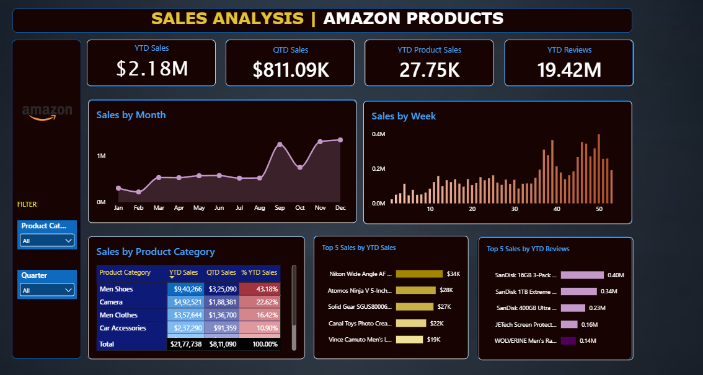

# 📊 Amazon Sales Analysis - End-to-End Power BI Project

An interactive end-to-end business intelligence dashboard built in Power BI to analyze Amazon product sales, customer reviews, and seasonal trends across multiple categories.

## 🚀 Project Overview
This project provides high-level business insights and granular performance metrics for Amazon sales data spanning multiple years (~89,000+ rows). It is designed to track revenue growth, category performance, and seasonal demand fluctuations to assist stakeholders in inventory and marketing decisions.

## 🛠️ Key Features & Technical Stack
- **Data Source & Modeling:** Connected to transactional Amazon data, built a custom dynamic **Date/Calendar Table** using DAX, and established clean **1-to-Many ($1:N$) relationships**.
- **Data Quality & Transformation:** Verified 100% data integrity using Power Query.
- **Advanced DAX Measures (Time Intelligence):**
  - **YTD Sales:** `TOTALYTD(SUM('Amazon'[Price ($)]), 'DateTable'[Date])`
  - **QTD Sales:** `TOTALQTD(...)`
  - **YTD Products Sold & Reviews**
- **Custom Chronological Sorting:** Implemented custom sort-by-column indexes for months and weeks.
- **Interactive Visualizations:**
  - **KPI Cards:** Displaying YTD Sales ($2.18M), QTD Sales ($811.09K), YTD Product Sales, and Total Reviews.
  - **Area Chart:** Monthly sales trend highlighting seasonal Q4 holiday spikes (Nov-Dec).
  - **Column Chart (Gradient Fill):** Granular weekly performance breakdown.
  - **Matrix Table with Conditional Formatting:** Category-wise breakdown showing YTD Sales, QTD Sales, and % of Grand Total.
  - **Bar Charts:** Top 5 products by YTD Sales and Customer Reviews using Top-N filters.
  - **Dynamic Slicers:** Multi-select product category and quarter filters.

## 📊 Dashboard Preview## 📊 Dashboard Preview

## 💡 Business Insights
- Significant sales surges occur in November and December due to festive/holiday seasons, requiring proactive inventory management.
- **Men Shoes** and **Cameras** are leading revenue-generating categories.
